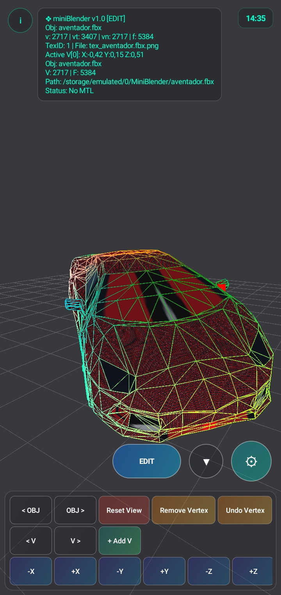
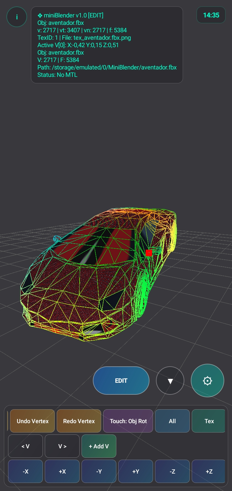
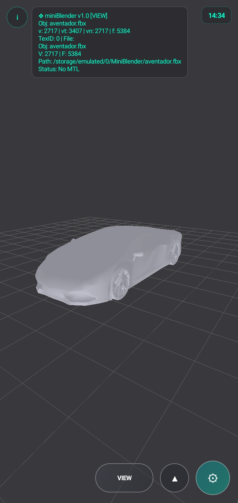

# ❖ miniBlender

**miniBlender** is a lightweight, native Android 3D mesh editor and viewer powered by **OpenGL ES 2.0**. Designed specifically for mobile 3D modeling, asset inspection, and retro/mobile game modding workflows, it brings essential viewport editing, multi-format model parsing, and texture mapping directly to Android devices.

---

## ✨ Key Features

- **Multi-Format 3D Model Import (`ModelParserLib`)**
  - **Autodesk FBX (`.fbx`)**: Supports both **Binary (v7.1–v7.7 with zlib decompression)** and **ASCII**, including full node hierarchy transformations (`Lcl Translation`, `Lcl Rotation`, `Lcl Scaling`).
  - **glTF 2.0 Binary (`.glb`)**: Fast binary buffer extraction for meshes, UVs, and indices.
  - **Stereolithography (`.stl`)**: Supports both Binary and ASCII formats.
  - **Polygon File Format (`.ply`)**: ASCII vertex/face parsing with UV support.
  - **Wavefront OBJ (`.obj`)**: Full support for vertices, UVs, normals, vertex colors, and `.mtl` material definitions.
  - **Legacy Game Formats (`.3d` & `.mdl`)**: Native ASCII `.3d` and binary `.mdl` import/export tailored for Symbian/PyS60 and mobile 3D engines.

- **Intuitive Mobile Touch Controls**
  - **Screen-Space Object Picking**: Tap any 3D object directly in the viewport to focus and select it.
  - **Gesture-Locked Dual Touch**:
    - **Pinch** to smoothly zoom the viewport camera.
    - **Two-Finger Drag** to rotate the active object in screen-aligned space without switching modes.
  - **Single-Finger Modes**: Switch seamlessly between **Room Orbit**, **Object Move**, and **Object Rotate**.

- **Direct Vertex & Mesh Editing**
  - Toggle between **EDIT Mode** (with custom RGB coordinate wireframe and active vertex marker) and **VIEW Mode**.
  - Move, add, extrude, remove, and undo/redo individual vertices along the X, Y, and Z axes.
  - Switch polygon winding order (`CCW` / `CW`) and recalculate vertex normals on the fly.

- **Texture & Scene Management**
  - Load custom **BMP** (8-bit, 24-bit, 32-bit) and **PNG/JPG** textures with automatic UV orientation handling.
  - Multi-object scene management with persistent JSON scene caching across sessions.
  - Export edited meshes directly to **`.3d`**, **`.mdl`**, or **`.obj`**.

---

## 📸 Screenshots

| Edit Mode & RGB Wireframe | Multi-Part FBX Binary Import | Textured View Mode |
| :---: | :---: | :---: |
|  |  |  |  |
---

## 🏗️ Architecture Overview

- **`MainActivity.java`**: Adaptive dark-glassmorphism HUD, collapsible vertex/transform control panels, floating action submenu, file picker integration, and About dialog.
- **`MyGLSurfaceView.java`**: Custom touch event pipeline with deadzone gesture locking (`Zoom` vs `Object Rotate`) and single-tap ray/projection picking.
- **`MyGLRenderer.java`**: OpenGL ES 2.0 rendering loop, camera/room orbit matrix stack, texture lifecycle management, and JSON scene persistence.
- **`MeshModel.java`**: GLSL shader programs (lit/textured surface shader, RGB wireframe shader, and active vertex point shader), VBO buffer management, and `.3d`/`.mdl`/`.obj` exporters.
- **`ModelParserLib.java`**: Standalone multi-format 3D parser engine for `.fbx`, `.glb`, `.stl`, and `.ply`.
- **`EditorObject.java` & `GridFloor.java`**: Per-object transform state (`offset`, `rotationMatrix`, `scale`) and 3D reference grid floor.

---

## 🚀 Build & Setup

1. Clone this repository:
   ```bash
   git clone https://github.com/sharooce/miniBlender.git
   ```
2. Open the project in **Android Studio** or **AIDE (Android IDE)**.
3. Ensure `minSdkVersion` is set to **21+** (OpenGL ES 2.0 supported) — no external third-party dependencies required.
4. Build and run on your Android device.

---

## 📄 License

This project is licensed under the **MIT License** — see the [LICENSE](LICENSE) file for details.
